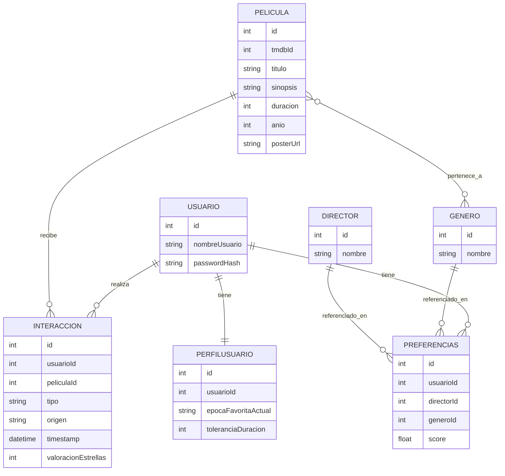
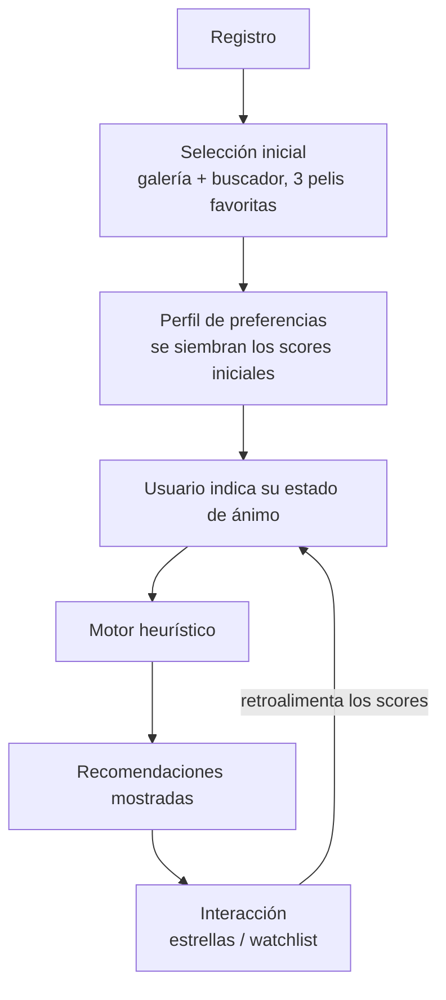
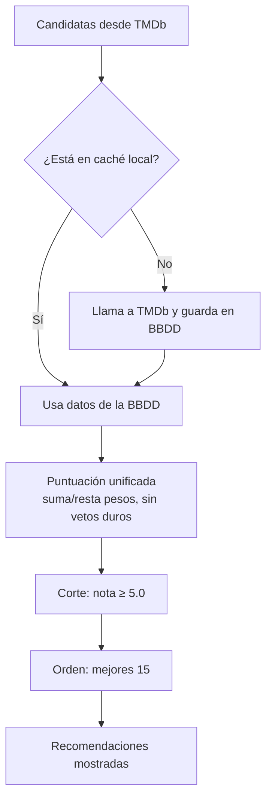
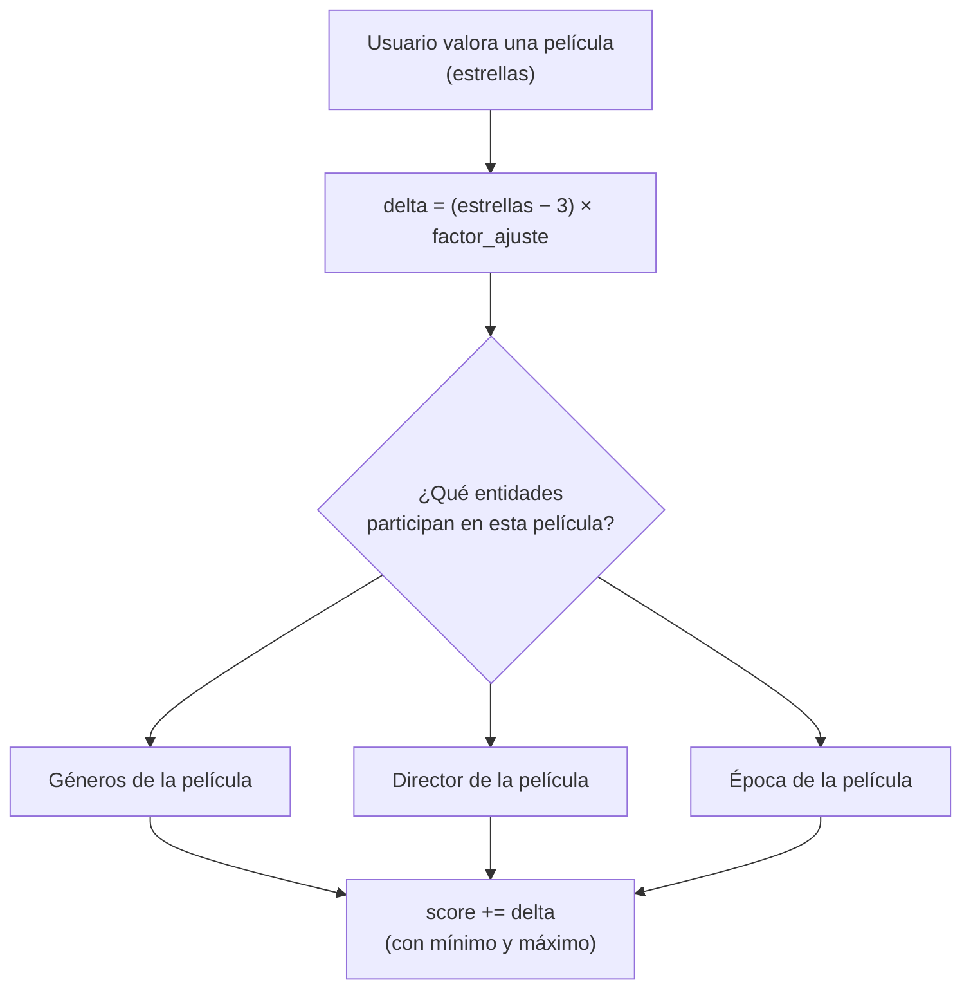

# Callahan — Motor de recomendación de cine (TFG)

> [!info] Qué es
> Motor de recomendación de cine. En vez de un catálogo infinito, se perfila al usuario por gustos concretos (géneros, directores, épocas) y se le pregunta por su estado de ánimo para dar recomendaciones muy afinadas. Estética brutalista inspirada en Saul Bass. TFG en solitario.

---

## 1. De dónde viene — v0.1 (verano)

- **Backend:** Java 17 + Spring Boot 3, Spring Security (BCrypt, sesiones stateful), Spring Data JPA/Hibernate.
- **BBDD:** H2 en memoria.
- **Frontend web:** monolito servido desde el backend, Vanilla JS/HTML5/CSS.
- **Integración externa:** TMDb API vía `RestTemplate`.
- **Arranque en frío original:** baraja de 21 pósteres estilo Tinder (aceptar/rechazar/ignorar).
- **Decisión de diseño original:** "vínculo ciego" — `Interaccion` solo guardaba un `peliculaID` suelto, sin tabla propia de películas.

**Por qué se rediseña:** el tutor valoró la idea, pero señaló que el proyecto dependía demasiado de datos externos (TMDb) y necesitaba más profundidad propia de BBDD para justificar la parte de datos + web de administrador.

---

## 2. Stack para los próximos 6 meses (v2, el TFG)

Arquitectura **polyrepo**:

| Pieza | Tecnología | Repo |
|---|---|---|
| API REST | Laravel + Eloquent | `callahan-api-laravel` |
| Web | Angular + TypeScript | `callahan-web-angular` |
| App móvil | Flutter + Dart | `callahan-app-flutter` |

**Monetización (alcance obligatorio, no extra):**
- La app en sí es **gratis**. El pago (Stripe + Laravel Cashier) solo desbloquea el acceso a la sección de IA.
- **"Detective IA" (premium):** conecta con OpenAI/Gemini para peticiones en lenguaje natural abstracto ("tuve un día horrible, quiero venganza estilo Kill Bill pero que me haga reír"). Es una capa de IA real, separada del motor de recomendación base, que sigue siendo heurístico.

> [!info] Alcance confirmado
> El panel de administrador, el modelo freemium con Stripe y la app móvil en Flutter son **obligatorios** — no quedan como extras condicionados al tiempo disponible.

---

## 3. Modelo de datos (ERD)

Filosofía: **caché local perezosa** — solo se guarda una película en la BBDD propia la primera vez que un usuario interactúa con ella, en vez de duplicar todo el catálogo de TMDb.



**Notas del modelo:**
- `Preferencias` tiene dos FKs nullable (`directorId`, `generoId`) — nunca las dos rellenas ni las dos a NULL a la vez. Se puede consultar todo junto con un solo `SELECT`.
- `Preferencias.score` ya no es una categoría fija (amado/odiado) — es un **score dinámico** que sube y baja con el uso (ver sección 5).
- `Interaccion` tiene FKs reales a `Usuario` y `Pelicula` (ya no hay "vínculo ciego").

> [!question] Abierto
> Cómo vigilar a nivel técnico que `Preferencias` nunca tenga las dos FKs rellenas o las dos a NULL a la vez: constraint `CHECK` (comprobar que el motor la aplica de verdad) vs. validación en código.

---

## 4. Onboarding y arranque en frío

Validado con encuesta propia (n=14-15): la gente recuerda bien sus películas favoritas, pero prefiere **clicar antes que escribir**. Se descartó el "Arquetipo de Detective" por el mismo problema de fricción que se quería evitar.



---

## 5. Algoritmo heurístico

> [!warning] Precisión para la memoria del TFG
> Todo esto es **heurístico auto-ajustable**, no Machine Learning. No hay función de pérdida ni optimización automática — son reglas de actualización aritmética definidas explícitamente. Cumple la definición amplia de Mitchell ("mejora con la experiencia"), pero no es lo que se entiende por ML en un contexto técnico (no hay modelo entrenado minimizando una función de coste).

### 5.1 Motor de puntuación (versión refinada)

Cambios respecto a la v0.1 original:
- El veto de **género** y el veto de **director** dejan de ser filtro duro → pasan a ser **penalización** dentro de la puntuación. Ya no se descarta nada de entrada.
- El bug de la **duración** (restar minutos directamente como puntos) se corrige con una **penalización lineal con tope**: cada minuto de exceso resta poco, con un máximo que nunca se supera.
- Antes de llamar a TMDb dentro del motor, se consulta primero la **caché local**.
- Los pesos dejan de ser constantes quemadas en código → viven en `ConfiguracionAlgoritmo`, editable.



> [!question] Abierto
> ¿El punto de partida de la puntuación sigue siendo `voteAverage` de TMDb (nota general del público), o debería pesar menos frente al encaje personal? Sin decidir todavía.

### 5.2 Señales de retroalimentación

Se sustituye el like/dislike binario original por señales más ricas:

| Señal | Tipo | Fiabilidad |
|---|---|---|
| Valoración 1-5 ★ (3★ = zona neutra, no mueve nada) | Explícita | Alta |
| Watchlist → vista → valorada | Implícita + explícita | Muy alta (la mejor señal) |
| Watchlist añadida (sola) | Implícita | Baja-media |

**Descartadas conscientemente** (demasiado ruidosas para el alcance del TFG, quedan como líneas futuras): tiempo hasta decidir, posición en la lista donde hace clic, recomendaciones mostradas e ignoradas.

### 5.3 Score dinámico por entidad — el corazón del aprendizaje

Cada **género**, **director** y **época** deja de tener una etiqueta fija (favorito/vetado) y pasa a tener un **score de afinidad** que se mueve con cada valoración. Esto permite que el gusto se desplace con el tiempo (ej. la época contemporánea puede "ganar terreno" sin que nadie cambie nada a mano).

**Fórmula de ajuste:**

```
delta = (estrellas - 3) × factor_ajuste
```

- `factor_ajuste` es una constante propia, editable desde `ConfiguracionAlgoritmo`.
- 3★ es la zona neutra: no mueve nada.
- **Atribución total:** el delta se aplica por igual a **todas** las entidades presentes en la película valorada (todos sus géneros incluidos) — no se reparte el crédito entre factores.
- Cada score tiene un **mínimo y máximo (clamp)** para no dispararse con el tiempo.
- **El onboarding siembra los valores iniciales:** los géneros/directores/épocas de las 3 películas favoritas elegidas al registrarse arrancan con un empujón inicial; el resto empieza en 0 (neutro).



**Ejemplo numérico — atribución total:**

*Película con 3 factores coincidentes, valorada con 5★* → `delta = (5-3) × 2 = +4`, aplicado a los tres:

| Entidad | Antes | Después |
|---|---|---|
| Director | 15 | 19 (+4) |
| Género | 10 | 14 (+4) |
| Época | 10 | 14 (+4) |

*Película con solo 2 factores coincidentes (Director y Época; el género no coincidía), valorada con 2★* → `delta = (2-3) × 2 = -2`:

| Entidad | Antes | Después |
|---|---|---|
| Director | 15 | 13 (−2) |
| Género | 10 | 10 (sin cambio — no participó) |
| Época | 10 | 8 (−2) |

> [!success] Efecto colateral resuelto
> Al ser el score dinámico e incremental por diseño, queda resuelta la decisión pendiente de `PerfilUsuario`: **se ajusta de forma incremental, no se recalcula todo el historial cada vez.**

---

## 6. Sobre el Machine Learning — por qué se descarta (razonado, no por falta de tiempo)

- Lo que se plantea sería **aprendizaje supervisado** (cada interacción es una etiqueta explícita: le gustó / no le gustó), no no-supervisado.
- Un modelo supervisado simple necesita del orden de 10 ejemplos etiquetados por variable → con ~5-8 variables, mínimo 50-80 interacciones **por perfil de usuario**, idealmente cientos. Con los usuarios reales de un TFG, inalcanzable.
- Se descartó también generar datos sintéticos con IAs "personificadas": un LLM con una personalidad asignada reproduce **estereotipos plausibles de gusto**, no las manías idiosincráticas reales que son el valor diferencial de Callahan. Además, seguiría siendo alguien (o algo) decidiendo los pesos a mano, solo que indirectamente.
- Conclusión: el heurístico auto-ajustable se queda como núcleo del algoritmo. Este análisis se documenta como parte crítica de la memoria, no como una carencia.

---

## 7. Panel de administrador

Pensado en tres capas: **observar** (métricas), **intervenir** (configuración editable) y **mantener** (moderación de caché / usuarios). No mezclar las tres a la hora de priorizar — son tipos de trabajo distintos.

### 7.1 Métricas (solo lectura)

- Géneros/directores/épocas con mayor y menor score medio, agregado entre todos los usuarios.
- Tasa de conversión **watchlist → vista → valorada**.
- Distribución de valoraciones (1-5★) — si casi todo es 4-5★, el corte de aceptación (`5.0`) probablemente está mal calibrado.
- Nota media de recomendaciones aceptadas vs. rechazadas.
- Volumen de la caché: películas guardadas vs. nunca consultadas — valida que la caché perezosa funciona de verdad.

### 7.2 Configuración editable (`ConfiguracionAlgoritmo`)

- `factor_ajuste` del score dinámico.
- Límites mínimo/máximo (clamp) de los scores.
- Peso y tope de la penalización de duración.
- Corte de aceptación (`5.0`) y tamaño de la lista final (`15`).
- Pesos base de época/director/género en la puntuación.

### 7.3 Moderación de caché

- Ver qué películas hay en caché y cuándo se guardaron.
- Forzar refresco manual de una película si el dato de TMDb quedó desactualizado.
- Purgar una entrada con datos erróneos.

### 7.4 Gestión de usuarios (alcance mínimo — vigilar aquí las horas)

- Listado básico: fecha de registro, nº de interacciones.
- Ver el "expediente" de un usuario (sus scores actuales) para depurar comportamientos raros del algoritmo.
- Activar/desactivar cuenta.

> [!warning] Alcance
> No meter roles/permisos complejos, edición manual de interacciones, exportación de datos ni auditoría de cambios — son features de panel "de producción", no necesarias para defender el TFG. Elegir 1-2 cosas por categoría como mínimo viable y anotar el resto como ampliación futura.

---

## 8. Hoja de ruta (hasta marzo)

### 8.1 Presupuesto de horas (recalculado)

| Tipo de semana | Nº semanas | Horas/semana | Subtotal |
|---|---|---|---|
| Semanas normales de clase | 16 | 7h (2h centro + 5h casa) | 112h |
| Semanas con puente | 4 | 7h base + 15h extra = 22h | 88h |
| Semanas de Navidad | 3 | 12h (sin clase) | 36h |
| **Total disponible** | **23** | | **~236h** |

### 8.2 Estimación de horas necesarias (todo el alcance es obligatorio)

| Bloque | Estimación |
|---|---|
| Heurístico (Java) — ya con la base hecha | 10h |
| API Laravel | 40-60h |
| Angular | 35-50h |
| Panel de administrador | 20-30h |
| Stripe (freemium) | 10-15h |
| Flutter | 40-60h |
| Detective IA | 10-15h |
| **Total** | **165-240h** |

> [!warning] Margen ajustado, no garantizado
> Con ~236h disponibles contra 165-240h necesarias, el plan **es viable si el escenario se acerca al rango bajo**, y queda **prácticamente sin margen si se va al rango alto** — habitual cuando se aprenden 3 tecnologías nuevas a la vez. El cálculo asume que las 15h/puente y las 12h/semana de Navidad se cumplen de verdad, sin cruces con exámenes u otros imprevistos. Revisar este margen según avancen los primeros puentes.

**Fase 0 — Refinamiento del heurístico en Java v0.1 (semanas 1-3, octubre)**
Solo lógica, sin tocar el esquema de la v0.1 (las tablas nuevas del ERD no se implementan aquí — sería trabajo desechable en JPA).

**Bloques (noviembre → febrero)** — todos obligatorios, se reordenan según cómo se den las tecnologías en clase:
- **Bloque A:** API en Laravel (esquema nuevo con Eloquent + lógica del heurístico ya refinada).
- **Bloque B:** Frontend web en Angular.
- **Bloque C:** Panel de administrador.
- **Bloque D:** Stripe (freemium) + Detective IA.
- **Bloque E:** App móvil en Flutter.

**Fase final (marzo)** — memoria y defensa, sin desarrollo nuevo.

> [!question] Abierto
> Orden real en que se darán Laravel, Angular y Flutter en clase, para fijar el orden definitivo de los bloques.

---

## 9. Todo lo que sigue abierto

- [ ] Constraint de `Preferencias`: `CHECK` vs. validación en código.
- [ ] Job nocturno de sincronización con TMDb: refrescar caché + populares de la semana, vs. endpoint `/movie/changes` — pendiente de hablarlo con el tutor.
- [ ] Orden real de las asignaturas en clase (afecta al orden de los bloques flexibles).
- [ ] Si `voteAverage` de TMDb debe seguir siendo el punto de partida de la puntuación, o pesar menos.
- [ ] Redactar en la memoria: hallazgo de la encuesta (fricción percibida vs. real en el onboarding).
- [ ] Redactar en la memoria: análisis crítico de por qué se descarta el ML real y los datos sintéticos.
- [ ] Decidir el mínimo viable del panel de administrador (qué entra de cada categoría), ya confirmado como obligatorio.
- [ ] Revisar el margen de horas real a medida que pasen los primeros puentes (el plan depende de que las 15h/puente y 12h/semana de Navidad se cumplan tal como están estimadas).
